# Схемы системы Apollo

Набор схем для описания системы: от контекста и сервисов до инфраструктуры и
масштабирования. Схемы написаны как Mermaid — рендерятся на GitHub и в IDE.
Пояснения и обоснование решений — в `docs/adr/` и `docs/architecture-scaling.md`.

Обозначения. Сплошная линия и рамка — реализовано в репозитории. Пунктир и
оранжевая заливка — целевая схема или отключённая на стенде интеграция. Серая
заливка — подстановка (мок) на стенде.

## 1. Контекст системы

Что находится вокруг платформы: кто присылает события, кому они доставляются и
от каких внешних систем зависит Apollo.

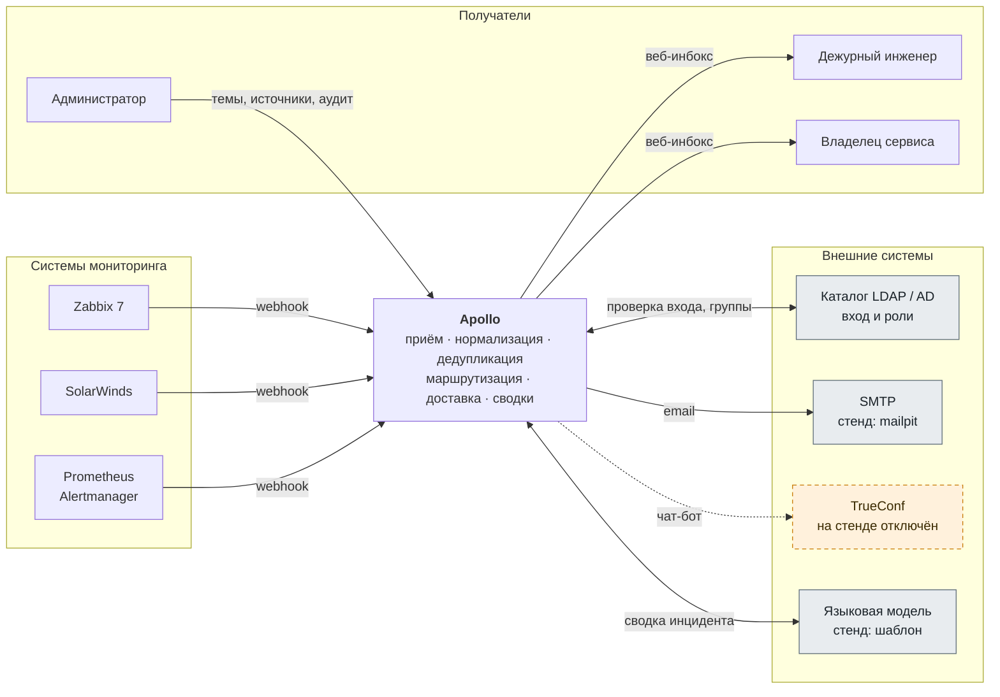
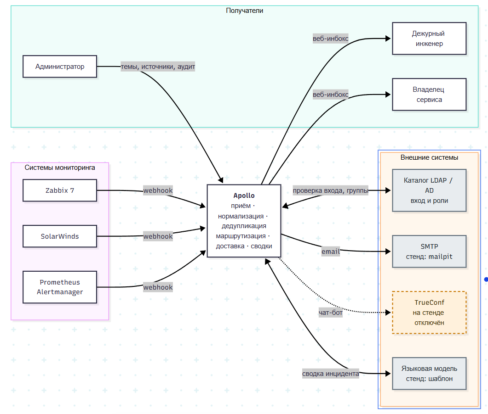

## 2. Сервисы и конвейер

Шесть отдельно запускаемых сервисов вокруг PostgreSQL. Стрелки к таблицам —
запись, обратные — выборка очереди. Вместо брокера сообщений очередью служат
сами таблицы (ADR-0001). Текст уведомления — сводка `llm`: `delivery` ждёт её
до 15 с, затем отправляет с исходным сообщением инцидента.

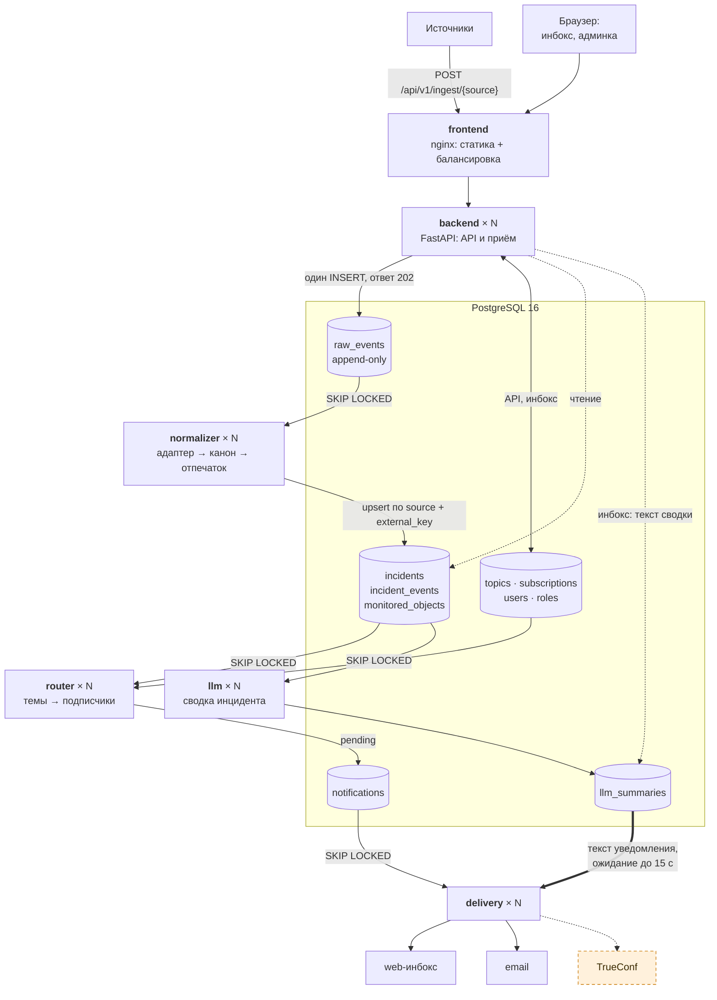

## 3. Путь события от вебхука до письма

Приём не парсит и не ждёт обработки: вебхук превращается в одну строку
`raw_events`, остальное делают воркеры асинхронно. Содержимое письма и
карточки инбокса — сводка языковой модели.

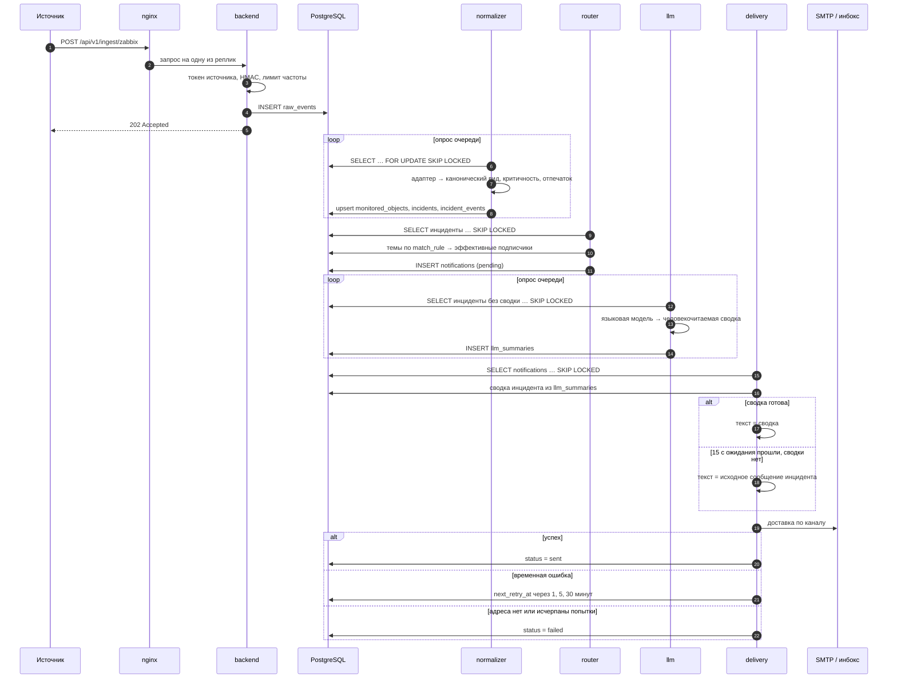

## 4. Жизненный цикл инцидента и уведомления

Повторное событие с тем же отпечатком `(source, external_key)` не создаёт
нового инцидента, а увеличивает счётчик. Внутри окна подавления оно не
порождает и нового уведомления.

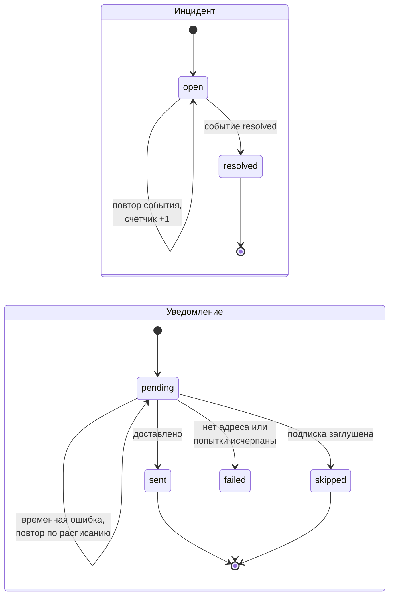

## 5. Модель данных

Пять слоёв: события, субъекты, подписки, доставка, служебное. Показаны основные
связи; полная схема с комментариями — `db/schema.sql`. `raw_events` и
`incident_events` секционированы по месяцам.

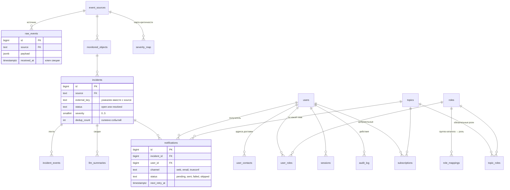

## 6. Инфраструктура стенда

Схема ниже — один хост (dev и локальная проверка). Публичный стенд разнесён на
два узла — приложение и БД на разных машинах, см. [`topology.md`](topology.md)
и ADR-0006. Базовый файл описывает продовый контур, dev-оверлей добавляет
подстановки внешних систем и публикацию портов на `127.0.0.1`.

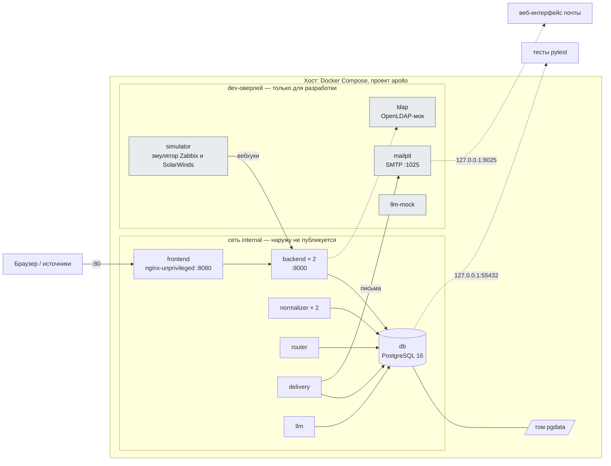

Ограничения контейнеров (все): non-root, `read_only` + tmpfs, `cap_drop: [ALL]`,
`no-new-privileges`, лимиты CPU и памяти. Наружу в проде опубликован только
порт 80.

## 7. Масштабирование: что и как

Каждый компонент масштабируется своим способом. Воркеры очереди и `backend` —
горизонтально, добавлением реплик; PostgreSQL — вертикально.

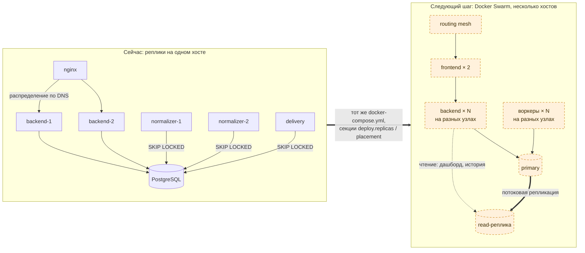

| Компонент | Как масштабируется | Механизм | Что ограничивает | Статус |
|---|---|---|---|---|
| `backend` | горизонтально | реплики за nginx, stateless (JWT в cookie) | пул соединений с БД; лимит частоты приёма считается на реплику | 2 реплики, не измерено |
| `normalizer` | горизонтально | `FOR UPDATE SKIP LOCKED` | БД | измерено: 1 → 3 |
| `delivery` | горизонтально | `SKIP LOCKED` | БД, скорость внешнего канала | измерено: 1 → 2 |
| `router`, `llm` | горизонтально | `SKIP LOCKED` (в коде есть) | БД; у `llm` — скорость модели | 1 реплика, не измерено |
| `frontend` (nginx) | горизонтально | реплики; при Compose порт 80 занимает одна | публикация порта | 1 реплика |
| PostgreSQL | вертикально + партиции | секции по месяцам | ядро и память узла | 1 инстанс |
| Read-реплика БД | целевая схема | потоковая репликация (ADR-0004) | ручное переключение | не реализовано |

Ручное масштабирование без правок кода:

```bash
docker compose up -d --scale backend=3 --scale normalizer=3 --scale delivery=2
```

## 8. Балансировка и отказ реплики

nginx резолвит имя `backend` через встроенный DNS Docker на каждый запрос
(кэш 10 секунд). Новые и пересозданные реплики подхватываются без перезапуска
nginx, стартовый адрес ротируется, при сбое реплики — повтор на соседней
(ADR-0003).

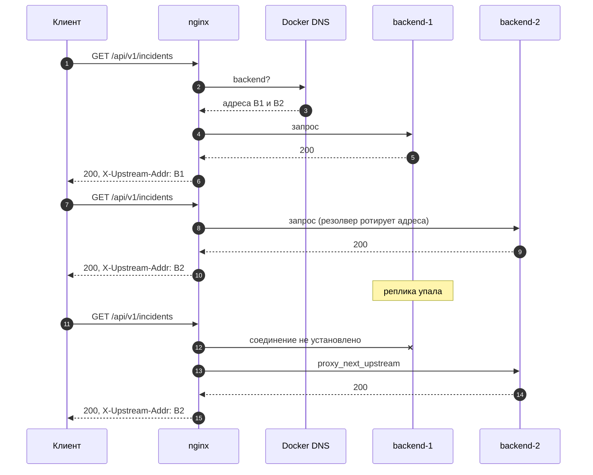

Почему не статический блок `upstream {}`: открытый nginx резолвит имена в нём
один раз при старте, и после пересоздания контейнера отдавал бы 502 на
устаревший адрес. Цена выбранного варианта — нет активных health-check и весов.

## 9. Как воркеры делят очередь

Координатор не нужен: строку, которую взяла одна транзакция, `SKIP LOCKED`
пропускает для остальных. Дублей нет, при падении воркера транзакция
откатывается, а строки возвращаются в очередь.

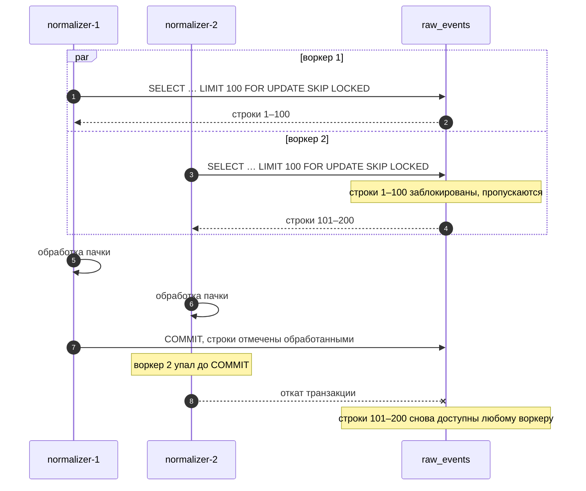

## 10. Что показали замеры

Один хост, `db` ограничена одним ядром и 512 МБ (`docs/load-test-report.md`,
1000 событий, 30 одновременных запросов).

| Показатель | 1 normalizer | 3 normalizer, 2 delivery |
|---|---|---|
| Приём → нормализация, p50 | 6.87 с | **0.79 с** |
| Приём → нормализация, p95 | 10.31 с | **3.30 с** |
| Вебхук → инцидент, p95 | 9.26 с | **2.78 с** |
| Фактическая частота приёма | 58.6 событий/с | **75.3 событий/с** |
| Инцидент → инбокс, p95 | 5.47 с | 21.94 с |

Вывод: первым упирается нормализатор (несколько запросов на событие), после его
расшивки узким местом становится PostgreSQL на одном ядре — задержка доставки
выросла. Репликация `backend` за nginx ещё не измерена.

## 11. Границы доверия

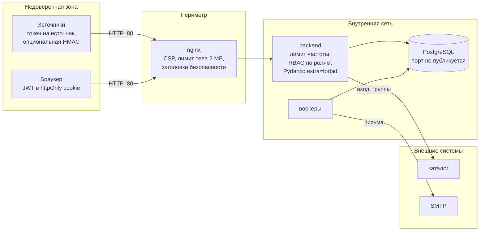

Слабые места периметра на сегодня: TLS на nginx не терминируется (шаг 13 плана
сборки), поэтому трафик до nginx идёт по HTTP. Персональные данные в логи не
попадают; контакты доставки хранятся только у локальных пользователей.


[def]: image.png