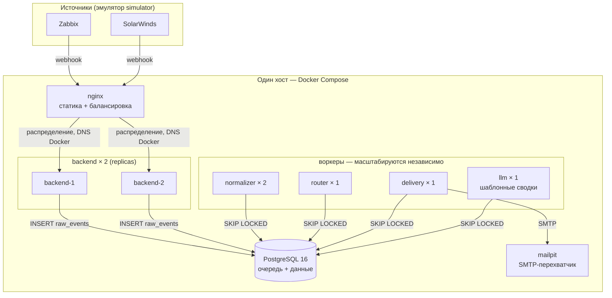

# Архитектура: масштабирование и балансировка

Расширение базовой архитектуры (`AGENTS.md` §6, `tz.md` §5) под требования
курсовой к распределённой, масштабируемой системе. Решения зафиксированы в
`docs/adr/` — этот документ даёт итоговую картину и честно разделяет три
вещи: **что реализовано и проверено**, **что реализовано, но не измерено** и
**что остаётся целевой схемой**.

Стенд — одна машина с Docker Compose. Внешние ВМ (каталог, LLM, Zabbix,
SolarWinds, TrueConf) недоступны, их заменяют подстановки dev-оверлея:
`ldap` (OpenLDAP), `mailpit` (SMTP), шаблонный генератор сводок
(`LLM_PROVIDER=template`) и `simulator` (эмулятор источников).

## Что есть сейчас

Число реплик задано в `deploy/docker-compose.yml` (`deploy.replicas`) и
меняется на лету: `docker compose up -d --scale backend=3 --scale normalizer=3`.
Пулы воркеров независимы — число `normalizer` не связано с числом `delivery`,
каждый снимает своё узкое место отдельно (ADR-0002).

## Как это устроено — без нового класса компонентов

Каждый элемент схемы — либо уже существующий компонент стека в нескольких
экземплярах, либо штатная возможность того же компонента, а не новая
технология.

| Слой | Технология | Что даёт масштабирование |
|---|---|---|
| Балансировка HTTP | `nginx` + Docker DNS (`resolver` и имя в переменной, `deploy/nginx.conf`) | распределение по всем репликам `backend` (резолвер nginx ротирует адреса), повтор запроса на другую реплику при сбое (`proxy_next_upstream`); почему не `upstream {}` — ADR-0003 |
| Приложение | FastAPI, stateless (JWT в cookie) | несколько реплик `backend`; единственное состояние в памяти — ограничитель частоты приёма, он считается на реплику |
| Очередь задач | Таблица PostgreSQL + `FOR UPDATE SKIP LOCKED` | множит воркеров без координатора — ADR-0002 |
| Хранилище | PostgreSQL 16, партиционирование по времени | один инстанс; read-реплика — целевая схема, ADR-0004 |
| Оркестрация | Docker Compose (`replicas` / `--scale`) | путь к Swarm без переписывания манифеста — ADR-0005 |

## Статус по компонентам

| Что | Статус | Основание |
|---|---|---|
| Масштабирование `normalizer` и `delivery` | **Реализовано и измерено** | `docs/load-test-report.md`, прогон 2: 3 нормализатора, задержка участка «приём → нормализация» упала в 8 раз без правок кода |
| Устойчивость воркера к перезапуску | **Реализовано и проверено** | тот же отчёт, раздел «Устойчивость к перезапуску»: потерь нет |
| Реплики `backend` за nginx | **Реализовано, не измерено** | `replicas: 2`, `X-Upstream-Addr` для наблюдения распределения; замеры 1/2/3 реплик ещё не проведены |
| Повтор запроса при отказе реплики | **Реализовано, не проверено на отказе** | `proxy_next_upstream` настроен; эксперимент с остановкой реплики под нагрузкой не проведён |
| TLS на nginx | Не реализовано | шаг 13 `build-prompts.md` |
| PostgreSQL primary + read-реплика | Целевая схема | ADR-0004; в compose нет, изменений в коде для разведения чтений не сделано |
| Несколько хостов (Swarm) | Целевая схема | ADR-0005 |
| Автоматический failover БД | Не планируется на MVP | — |

Пока замеры репликации `backend` не сделаны, в отчёте и на защите нельзя
утверждать, что приём масштабируется линейно: в прогоне 2 отчёта о нагрузке
узким местом после нормализатора стал сам PostgreSQL на одном ядре, и есть
основания ждать того же от нескольких реплик `backend`.

## Ограничения текущего стенда

- **Всё на одном хосте** — «кластер» здесь означает несколько контейнеров,
  а не несколько машин. Отказ хоста отказывает всему; балансировка защищает
  от отказа реплики, не узла.
- **БД — единая точка отказа и первое узкое место** (см. отчёт о нагрузке).
- **Ограничитель частоты приёма считается на реплику**: при N репликах
  реальный лимит на источник до N × `INGEST_RATE_LIMIT_RPS` (ADR-0003).
- **Пул соединений на процесс**: суммарное число соединений растёт с числом
  реплик, поэтому `max_connections` в compose поднят до 200.
- **Сводки инцидентов — шаблонные**: поля и метрики события подставляются в
  готовые формулировки (`adapters/llm/template.py`), детерминированно и без
  модели. Клиент к OpenAI-совместимому endpoint остаётся в коде и включается
  `LLM_PROVIDER=openai`; этим и объясняется, что в стенде нет ВМ с GPU.
- **Канал TrueConf отключён**, его роль на стенде играет email через mailpit.

## Соответствие требованиям задания

| Требование | Реализация в Apollo |
|---|---|
| Не classic client-server | Событийный конвейер: приём → очередь в БД → нормализация → маршрутизация → доставка, несколько независимых сервисов |
| Продвинутая серверная архитектура / микросервисы | 6 отдельно запускаемых и масштабируемых сервисов (`backend`, `normalizer`, `router`, `delivery`, `llm`, `frontend`) вокруг общей БД-очереди; сознательно не «микросервисы с брокером» — ADR-0001 |
| БД, типологическая схема | `db/schema.sql` — 5 слоёв (события, субъекты, подписки, доставка, служебное) |
| Разместить на сервере | Стенд собирается одной командой из `deploy/docker-compose.yml`; развёртывание на внешнем сервере **пока не выполнено** |
| Кластеры / масштабирование | Воркеры масштабируются штатно и измерены; `backend` — реплики настроены, замеры впереди; БД — вертикально, read-реплика как целевая схема |
| Балансировщики | nginx: распределение по репликам `backend` через Docker DNS + повтор на соседнюю реплику |
| Вести git | Ведётся с начала проекта |
| Агентная разработка, md + понимание кодовой базы | `AGENTS.md`, `CLAUDE.md`, `docs/tz.md`, `docs/build-prompts.md`, `docs/adr/` — история архитектурных решений; карта файлов — `docs/agentic-development.md` |

## Что не делаем и почему

Ограничения — обратная сторона решений в `docs/adr/`, а не пропуск:

- **Kafka/RabbitMQ/Redis** — не нужны, очередь в PostgreSQL справляется на
  объёме кейса с большим запасом (ADR-0001).
- **Kubernetes** — избыточен для одного хоста и срока курсовой; путь тиража
  (ADR-0005).
- **Шардирование БД** — не тот объём данных; партиционирования по времени и
  read-реплики достаточно (ADR-0004).
- **Автоматический failover БД** (Patroni/repmgr) — на MVP переключение на
  реплику ручное; автоматизация — пункт тиража.

## Что осталось доделать для курсовой

1. Прогнать нагрузку при 1, 2 и 3 репликах `backend` (`tools/load_generator.py`,
   `tools/check_pipeline.py`) и занести результаты в `docs/load-test-report.md`.
2. Остановить одну реплику `backend` под нагрузкой и убедиться, что
   `proxy_next_upstream` не даёт потерь.
3. Решить, добавлять ли read-реплику PostgreSQL (ADR-0004) или оставить как
   описанную целевую схему.
4. Развернуть на внешнем сервере, если преподаватель этого требует.
