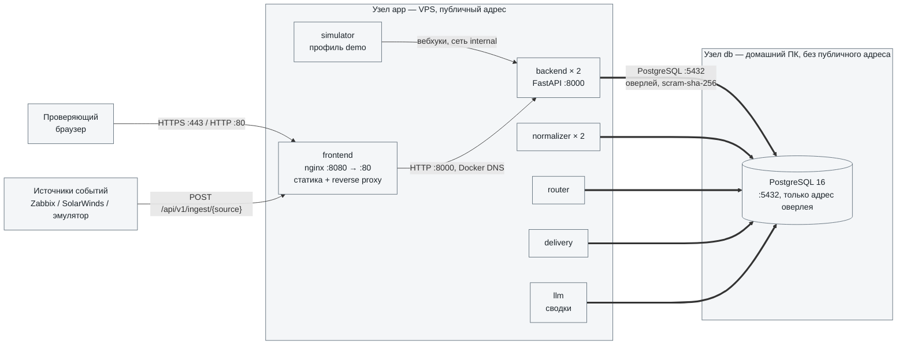
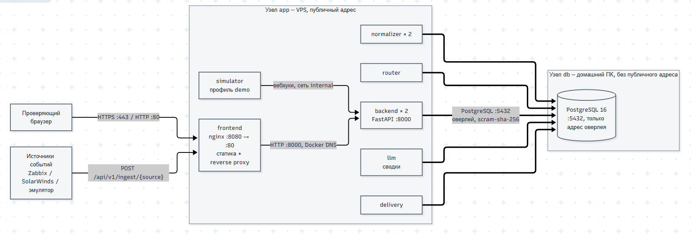

# Топология развёртывания

Публичный стенд состоит из **двух узлов** на разных машинах. Решение и
отвергнутые варианты — [ADR-0006](adr/0006-two-node-topology.md).

| Узел | Машина | Роль | Compose |
|---|---|---|---|
| **app** | арендованный VPS, публичный адрес | точка входа, статика, API, воркеры | `docker-compose.yml` + `docker-compose.app-node.yml` |
| **db** | домашний ПК, без публичного адреса | PostgreSQL 16, единственное хранилище состояния | `docker-compose.db-node.yml` |

## 1. Топологическая схема




Двойные стрелки — единственный сетевой маршрут между узлами. Остальные связи
внутри узла app идут по внутренней сети Compose `internal`, наружу не
публикуются.

## 2. Сетевые маршруты

| Откуда | Куда | Протокол, порт | Сеть | Защита |
|---|---|---|---|---|
| Браузер, источники | frontend (узел app) | HTTP :80, при TLS-терминаторе — HTTPS :443 | интернет | CSP, HSTS, лимит тела, токен источника + HMAC, лимит частоты |
| frontend | backend ×2 | HTTP :8000 | `internal` | внутренняя сеть, `proxy_next_upstream` |
| backend, normalizer, router, delivery, llm | PostgreSQL (узел db) | PostgreSQL :5432 | оверлей | публикация только на адрес оверлея, ACL, `pg_hba`, scram-sha-256 |
| backend | LDAP / AD | LDAPS :636 | зависит от развёртывания | при `AUTH_PROVIDER=local` не используется |
| delivery | SMTP, TrueConf | SMTP / WebSocket | внешняя | на стенде отключены (`SMTP_HOST` пуст) |
| llm | языковая модель | HTTP | внешняя | на стенде `LLM_PROVIDER=template`, сеть не нужна |
| администратор | оба узла | SSH | интернет / оверлей | только по ключу |

Наружу из узла app открыты порты 22 (SSH) и 80/443. Из узла db наружу не
открыто **ничего**: порт 5432 слушает адрес оверлея.

## 3. Почему сервисы разделены именно так

| Компонент | Ответственность | Почему отдельно |
|---|---|---|
| **frontend** (nginx) | статика SPA, reverse proxy, заголовки безопасности, балансировка по репликам backend | единственная публичная точка; не содержит логики, поэтому его уязвимости не дают доступа к данным; масштабируется и заменяется независимо |
| **backend** (FastAPI) | приём вебхуков, REST API, аутентификация | приём обязан отвечать за миллисекунды и не ждать обработки; stateless, поэтому реплик может быть сколько угодно (ADR-0003) |
| **normalizer** | адаптер → канонический формат → инцидент | самая дорогая часть конвейера (узкое место при 58–75 событий/с); тот же образ, но масштабируется отдельно от API (ADR-0002) |
| **router** | темы → подписчики → уведомления | другая частота и профиль нагрузки; сбой не теряет инциденты — уведомления доначисляются |
| **delivery** | web-инбокс, email, TrueConf, повторы | ходит во внешние системы с их таймаутами; медленный SMTP не должен тормозить конвейер |
| **llm** | сводки инцидентов | секунды на ответ модели при бюджете «событие → инбокс» в 5 с; остановка воркера не влияет ни на приём, ни на доставку |
| **PostgreSQL** | состояние и очередь (ADR-0001) | единственный узел с данными: отдельная машина позволяет обновлять и перезапускать приложение без риска для данных, а данные — резервировать отдельно |
| **simulator** | эмуляция Zabbix/SolarWinds | заменяет недоступные боевые источники; профиль `demo`, в боевую конфигурацию не входит |

Вынесены в отдельные процессы **все воркеры** (normalizer, router, delivery,
llm) и **БД на отдельную машину**. Воркеры общаются друг с другом только через
таблицы PostgreSQL (`FOR UPDATE SKIP LOCKED`), а не напрямую: это то, что
позволяет запускать любое число реплик и терять любую из них без потери событий.

## 4. Интерфейсы между компонентами

| Интерфейс | Контракт |
|---|---|
| Источник → frontend → backend | `POST /api/v1/ingest/{source}`, заголовки `X-Webhook-Token` и опционально `X-Webhook-Signature` (HMAC-SHA256 hex от тела). Ответ `202 {"status":"accepted","raw_event_id":N}`. Ошибки: `401` токен, `403` адрес не в списке, `413` тело больше лимита, `429` частота (`Retry-After: 1`), `503` БД недоступна (`Retry-After: 5`) |
| Браузер → backend | REST `/api/v1/*`: `auth`, `incidents`, `notifications`, `subscriptions`, `topics`, `sources`, `users`, `admin`, `dashboard`. JWT в `httpOnly` cookie. Единый формат ошибок `{"error":{"code","message","request_id"}}`. Полная схема — `GET /api/v1/openapi.json` |
| Проверки живости | `GET /health` — процесс жив (`200`). `GET /health/ready` — БД доступна: `200` или `503` |
| backend / воркеры → БД | SQL через SQLAlchemy/asyncpg; очередь — `raw_events`, `incidents`, `notifications` со `SKIP LOCKED` |
| Воркер → воркер | напрямую не общаются: только через таблицы |

Формат ошибок и коды — `backend/app/api/errors.py`; канонический формат
события — `docs/tz.md` §7.

## 5. Схема данных

ER-диаграмма — [`architecture-diagrams.md`](architecture-diagrams.md) §5,
полное описание таблиц и индексов с комментариями — [`db/schema.sql`](../db/schema.sql)
(источник истины). Миграции — `backend/alembic/versions/`.

Ключевое: `raw_events` и `incident_events` только дополняются и партиционированы
по месяцам; `incidents` изменяется только через `INSERT … ON CONFLICT DO UPDATE`
по `(source, external_key)`; `notifications` — очередь доставки.

## 6. Поведение при недоступности узла

Сценарии 1 и 2 проверены на разнесённом стенде (БД и приложение — отдельные
Compose-проекты, связь по сети через опубликованный порт) 2026-09-21.
Сценарии 3–6 следуют из устройства конвейера (ADR-0001, ADR-0002) и
экспериментально на разнесённом стенде не воспроизводились.

| Что отказало | Что видит пользователь | Что происходит внутри | Восстановление |
|---|---|---|---|
| **1. Узел db выключен или потеряна связь** | статика открывается (`/` → 200); вход и данные — `503 DATABASE_UNAVAILABLE`; `/health` = 200, `/health/ready` = 503 | вебхуки получают `503` + `Retry-After: 5` (отправитель повторяет), не `500`; воркеры перехватывают ошибку цикла и повторяют его (`workers/runner.py`): все контейнеры оставались `Up`; ответ за ~20 мс — подключение ограничено 5 с (`DB_CONNECT_TIMEOUT_S`) | автоматически: после возврата узла db `/health/ready` = 200, приём снова `202`, перезапуск контейнеров не нужен |
| **2. Упала одна реплика backend** | ничего: 6 из 6 запросов `202` | nginx перебрасывает запрос на живую реплику (`proxy_next_upstream`, ADR-0003) | `docker compose up -d` поднимает реплику |
| **3. Остановлена реплика normalizer** | ничего | оставшаяся реплика разбирает очередь; событие в `raw_events` уже принято и не теряется | реплика возвращается и продолжает делить очередь |
| **4. Узел app недоступен** | сайт недоступен | данные целы на узле db; вебхуки источников получают ошибку соединения и повторяют по своим правилам | `docker compose up -d` на узле app; миграции не нужны |
| **5. Упал воркер llm** | сводки не обновляются | приём, нормализация и доставка не затронуты | перезапуск; необработанные инциденты подхватываются |
| **6. Недоступны SMTP / TrueConf** | уведомления канала `failed` после повторов | web-инбокс работает; повторы 1, 5, 30 минут | после восстановления канала |

Если БД недоступна **в момент старта**, backend всё равно поднимается: зависимость
`depends_on: db` в оверлее приложения снята намеренно, готовность отражает
`/health/ready`.

Что не проверялось: молчаливая потеря пакетов до узла db (не отказ соединения, а
таймаут) — ограничение 5 с задано, но экспериментально на реальном оверлее не
измерено; потеря самих данных при отказе диска узла db — резервная копия и
реплика (ADR-0004) не развёрнуты.

## 7. Развёртывание

Оба узла уже должны быть в одной оверлейной сети (см. ниже).

**Оверлей.** Tailscale на обеих машинах, вход в один аккаунт. В ACL сети
разрешить узлу app доступ к узлу db на порт 5432, всё остальное — запретить.
Адрес узла db (`100.x.y.z`) далее — `DB_OVERLAY_ADDR`.

**Узел db.** В `.env` на этой машине: `POSTGRES_USER`, `POSTGRES_PASSWORD`,
`POSTGRES_DB` и `DB_BIND_ADDR=<DB_OVERLAY_ADDR>`.

```bash
cd deploy
docker compose -f docker-compose.db-node.yml up -d
```

Если на машине уже занят порт 5432 — `DB_BIND_PORT=<порт>` и тот же порт в
`DATABASE_URL`.

**Узел app.** В `.env`: тот же пароль, `DATABASE_URL=postgresql+asyncpg://apollo:<пароль>@<DB_OVERLAY_ADDR>:5432/apollo`,
`AUTH_PROVIDER=local`, свои `JWT_SECRET` и `INGEST_TOKEN_*`, `SMTP_HOST=` (пусто:
почтового сервера на стенде нет), `LLM_PROVIDER=template`.

```bash
cd deploy
docker compose -f docker-compose.yml -f docker-compose.app-node.yml --profile demo up -d --build
docker compose -f docker-compose.yml -f docker-compose.app-node.yml exec backend alembic upgrade head
docker compose -f docker-compose.yml -f docker-compose.app-node.yml exec backend python -m app.cli sync-tokens
docker compose -f docker-compose.yml -f docker-compose.app-node.yml exec backend python -m app.cli create-admin breakglass --password '<пароль>'
docker compose -f docker-compose.yml -f docker-compose.app-node.yml exec backend python -m app.seed
docker compose -f docker-compose.yml -f docker-compose.app-node.yml exec backend python -m app.demo_seed --password '<пароль>'
```

**Публичный URL.** Домен и порты 80/443 на VPS держит системный nginx с certbot.
Контейнер frontend в оверлее узла app публикуется только на `127.0.0.1:8088`,
системный nginx терминирует TLS и проксирует на него. В `.env` — `COOKIE_SECURE=true`.
В `server` с `listen 443 ssl` домена, который выпустил certbot:

```nginx
client_max_body_size 2m;

location / {
    proxy_pass http://127.0.0.1:8088;
    proxy_set_header Host $host;
    proxy_set_header X-Real-IP $remote_addr;
    proxy_set_header X-Forwarded-For $proxy_add_x_forwarded_for;
    proxy_set_header X-Forwarded-Proto https;
}
```

```bash
sudo nginx -t && sudo systemctl reload nginx
```

Ограничение: nginx контейнера перезаписывает `X-Real-IP` своим `$remote_addr`, поэтому
бэкенд видит адрес шлюза docker, а не клиента. На стенде это не мешает: лимит частоты
считается по источнику, эмулятор шлёт вебхуки по внутренней сети. Для боевого источника
с `ip_allowlist` за таким прокси нужен `real_ip` в nginx контейнера.

Проверять адрес нужно из другой сети (телефон по мобильной сети), а не с машин
самого стенда.

**Проверка после запуска:**

```bash
curl -s https://<APP_URL>/health/ready          # {"status":"ready"}
docker compose -f docker-compose.yml -f docker-compose.app-node.yml ps
```
